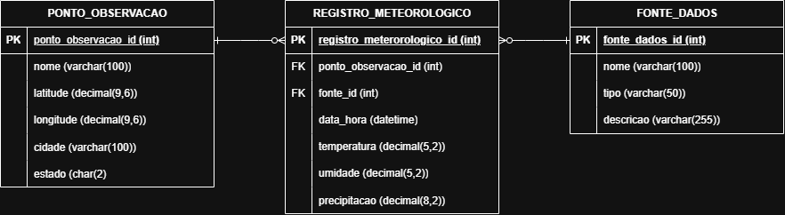

# Nimbus

**Sistema de Análise de Dados Meteorológicos** desenvolvido em Python para a disciplina de Programação Aplicada (PAV).

**Integrantes:** Natan Mauricio Santos e Arthur Maia Rangel.

> **Status:** Planejamento e especificação. As funcionalidades descritas ainda precisam ser implementadas e testadas.

## 1. Objetivo

O Nimbus organiza observações meteorológicas coletadas em diferentes momentos e pontos geográficos. O sistema permitirá cadastrar pontos de observação e fontes de dados, armazenar temperatura, umidade e precipitação, consultar históricos e calcular estatísticas e comparações por período e ponto.

O projeto vai além de um CRUD ao incluir análise estatística e importação validada de arquivos CSV.

## 2. Funcionalidades previstas

- Cadastro, consulta, edição e exclusão de pontos de observação.
- Cadastro, consulta, edição e exclusão de fontes de dados.
- Cadastro, consulta, edição e exclusão de registros meteorológicos.
- Importação de observações por CSV.
- Filtros por período e ponto de observação.
- Cálculo de média, mínimo e máximo.
- Comparação entre períodos ou pontos.
- Validação de dados e relatório de linhas rejeitadas na importação.

## 3. Modelo de dados

O modelo inicial possui três tabelas relacionadas.

### `ponto_observacao`

Representa um **ponto geográfico específico**, como uma estação meteorológica ou um local definido por coordenadas. Não representa automaticamente uma cidade inteira.

| Campo | Descrição |
|---|---|
| `id` | Chave primária. |
| `nome` | Nome do ponto ou estação. |
| `latitude` | Latitude em graus decimais. |
| `longitude` | Longitude em graus decimais. |
| `cidade` | Município (complementar). |
| `estado` | Estado (complementar). |

### `fonte_dados`

| Campo | Descrição |
|---|---|
| `id` | Chave primária. |
| `nome` | Nome da fonte. |
| `tipo` | Categoria da fonte. |
| `descricao` | Descrição opcional. |

### `registro_meteorologico`

| Campo | Descrição |
|---|---|
| `id` | Chave primária. |
| `ponto_observacao_id` | Chave estrangeira para `ponto_observacao`. |
| `fonte_dados_id` | Chave estrangeira para `fonte_dados`. |
| `data_hora` | Momento da observação. |
| `temperatura` | Temperatura em graus Celsius (°C). |
| `umidade` | Umidade relativa (%). |
| `precipitacao` | Precipitação em milímetros (mm). |

**Relacionamentos:** um ponto de observação pode ter muitos registros; uma fonte pode estar associada a muitos registros. Cada registro referencia um ponto e uma fonte existentes.

A combinação `fonte_dados_id + ponto_observacao_id + data_hora` será única para impedir observações duplicadas da mesma fonte no mesmo ponto e instante.

### Modelagem do Banco de Dados

O diagrama abaixo apresenta as entidades e os relacionamentos do banco de dados do Nimbus.



O arquivo editável está disponível em:
`docs/modelo_entidade_relacionamento.drawio`.

## 4. Regras de negócio principais

1. Cada registro deve estar associado a um ponto de observação cadastrado.
2. Temperatura, umidade, precipitação, data/hora, ponto e fonte são obrigatórios.
3. Umidade deve estar entre 0% e 100%.
4. Precipitação não pode ser negativa e é armazenada em mm.
5. Temperatura deve estar entre −90 °C e 60 °C, inclusive.
6. Datas e horas devem ser válidas e não podem estar no futuro.
7. A fonte de dados deve existir.
8. Não é permitido excluir ponto ou fonte que possua registros associados.
9. A data inicial de uma consulta deve ser anterior ou igual à data final.
10. Estatísticas devem respeitar os filtros; sem resultados, o sistema deve informar que não há dados.
11. Não pode haver dois registros com a mesma fonte, ponto e data/hora.
12. Linhas inválidas ou duplicadas no CSV devem ser identificadas no relatório de importação.
13. Latitude deve estar entre −90 e 90 graus.
14. Longitude deve estar entre −180 e 180 graus.
15. Nome, latitude e longitude são obrigatórios para um ponto de observação.

## 5. Formato CSV proposto

O padrão inicial usa codificação UTF-8, separador `;`, ponto como separador decimal e data/hora em `AAAA-MM-DD HH:MM:SS`.

```csv
ponto_observacao_id;fonte_dados_id;data_hora;temperatura;umidade;precipitacao
1;1;2026-10-10 14:00:00;23.5;72;0.0
1;1;2026-10-10 15:00:00;24.1;68;0.2
2;1;2026-10-10 14:00:00;21.8;80;1.4
```

Os IDs devem corresponder a pontos de observação e fontes previamente cadastrados. A API validará campos, tipos, limites, datas futuras e duplicidades. O relatório de importação indicará quantidades importadas e rejeitadas e o motivo de cada rejeição.

## 6. Tecnologias

| Componente | Tecnologia |
|---|---|
| Linguagem | Python |
| API REST | Flask-RESTful |
| ORM | SQLAlchemy |
| Banco de dados | MySQL |
| Interface gráfica | Tkinter |
| Comunicação HTTP | `requests` |
| Leitura de CSV | Biblioteca padrão `csv` |
| Containers | Docker e Docker Compose |
| Versionamento | Git |

As escolhas seguem as alternativas previstas no enunciado. A interface será executada fora dos containers; API e banco ficarão em containers separados. SQLite não será utilizado.

## 7. Arquitetura planejada

```text
Nimbus/
├── projeto_API/
│   ├── entities/
│   ├── controllers/
│   ├── services/
│   ├── repositories/
│   ├── routes/
│   ├── config/
│   ├── app.py
│   ├── requirements.txt
│   └── Dockerfile
├── interface/
│   ├── telas/
│   ├── services/
│   ├── app.py
│   └── requirements.txt
├── database/
│   └── init.sql
├── docker-compose.yml
├── .env.example
├── .gitignore
└── README.md
```

- `entities`: modelos SQLAlchemy e relacionamentos.
- `repositories`: acesso ao banco.
- `services`: regras de negócio, importação e estatísticas.
- `controllers`: coordenação de requisições e respostas.
- `routes`: endpoints HTTP.
- `config`: configurações da aplicação.
- `interface`: telas e chamadas HTTP à API.

Fluxo: **interface → API → services/repositories → MySQL**. A interface não acessará o banco diretamente.

## 8. Divisão de responsabilidades

- **Natan Maurício Santos:** banco de dados, script SQL, modelos SQLAlchemy, backend, API REST, regras de negócio e importação CSV no backend.
- **Arthur Maia Rangel:** frontend em Tkinter, telas, formulários, seleção de CSV, comunicação HTTP com a API e apresentação dos resultados e erros.
- **Em conjunto:** testes integrados, Docker, revisão de código, documentação e apresentação. Ambos devem compreender a arquitetura geral e as partes que apresentarem.

## 9. Fases de desenvolvimento

1. **Especificação e planejamento:** revisar e aprovar requisitos, regras, modelo e tecnologias.
2. **Banco e modelos:** criar `init.sql`, configurar SQLAlchemy e testar relacionamentos.
3. **API REST:** implementar POST, GET, PUT e DELETE para cada entidade.
4. **Análises e importação:** implementar filtros, estatísticas, comparações e importação CSV.
5. **Interface gráfica:** desenvolver telas e integrar com a API.
6. **Dockerização:** executar API e MySQL em containers separados.
7. **Testes integrados:** testar regras, erros, persistência, importação e comunicação.
8. **Documentação e apresentação:** finalizar instruções, slides e roteiro de demonstração.

## 10. Critérios de conclusão

- [ ] Três tabelas relacionais com modelos SQLAlchemy.
- [ ] Operações POST, GET, PUT e DELETE para cada entidade.
- [ ] Regras de negócio aplicadas na API.
- [ ] Interface conectada à API.
- [ ] Estatísticas e comparações além do CRUD.
- [ ] Importação CSV validada.
- [ ] API e banco em containers separados.
- [ ] Script SQL e `docker-compose.yml` entregues.
- [ ] Testes e demonstração preparados.
- [ ] README e slides revisados.

## 11. Como executar

Os comandos de execução serão adicionados quando os arquivos da API, banco e interface estiverem implementados e testados. O projeto deverá permitir iniciar API e banco pelo Docker Compose e executar a interface separadamente.

## 12. Referências

- Enunciado do trabalho PAV.
- Documento inicial `REGRA DE NEGÓCIOS.pdf`.

Este README descreve o planejamento; não afirma que funcionalidades ainda não implementadas já estejam disponíveis.
